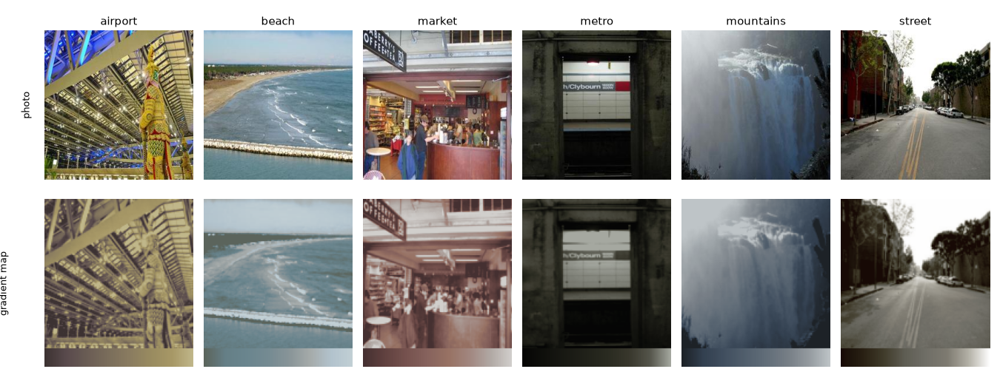
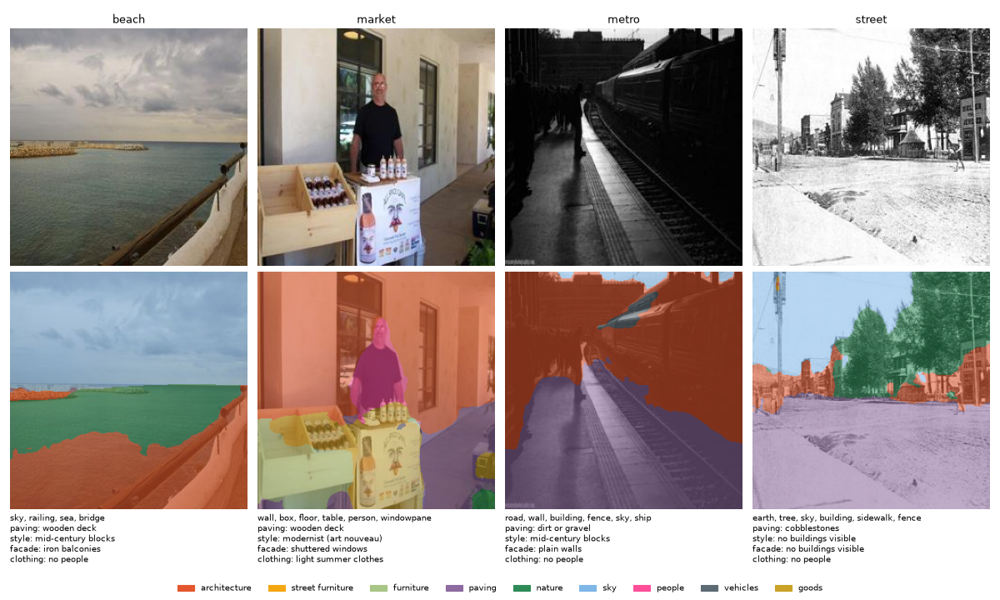
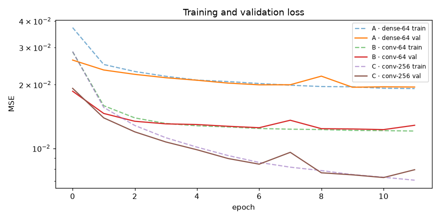
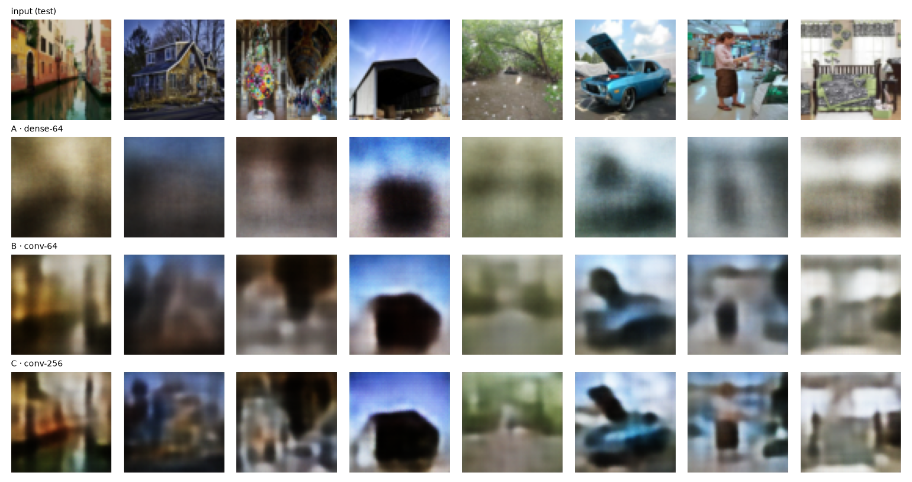
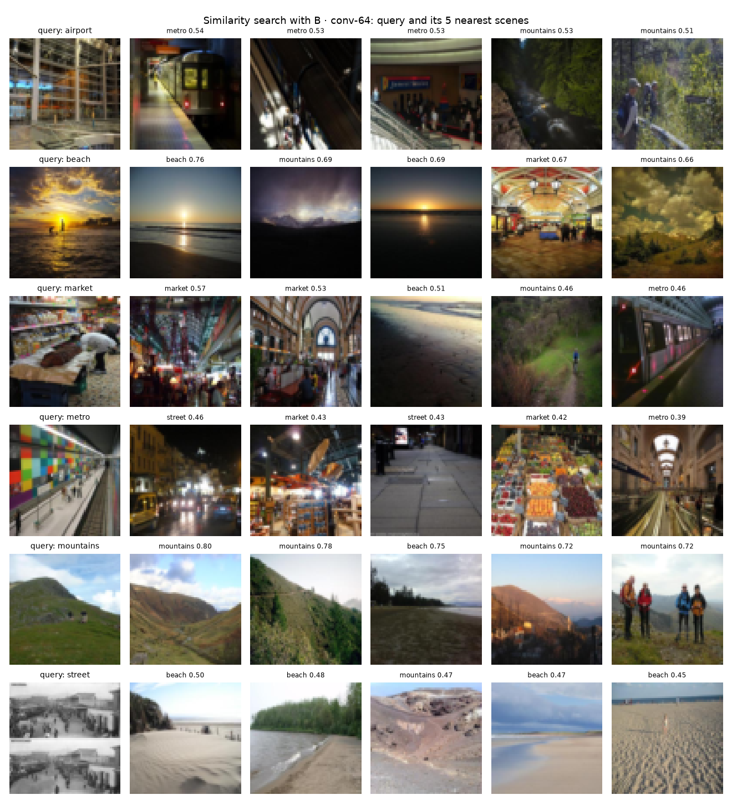
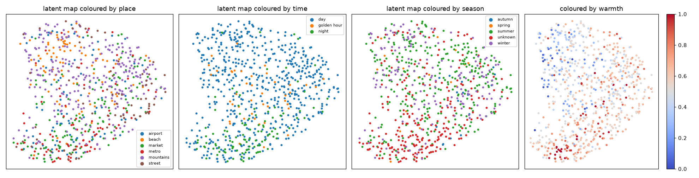

# 01 · Image side: from a photo to a scene card

**Group 08 · Chroma · AI Methods hackathon, IAAC MaAI, 16–20 November 2026**
**Owner of this part:** Akshat · **Model:** [huggingface.co/iaac-maai/hackathon-team8-chroma-ae](https://huggingface.co/iaac-maai/hackathon-team8-chroma-ae)

This folder is everything that happens to a photo **before** the music: it is cleaned, labelled,
measured and compressed by an autoencoder, so that the app can send the music a
[scene card](../music/scene-card/README.md) (place, time of day, colours).

It works on a photo of **any city**. The model learns from 36,500 photos of places from all over the
world. **Barcelona** is our home city: the demo photos, our own photos and the Wikimedia set are from here.

> Status (Tuesday): data, labels, gradient maps, detail recognition, the library and the autoencoder
> (three setups, ONNX checked, on Hugging Face) are done. Next: Barcelona photos (Wikimedia) in the library.

---

## 1. What a photo goes through

```
photo
  │
  ├─ 1. clean ─────────── is it a place?   remove close-ups of people, animals, objects (object detector)
  │
  ├─ 2. label ─────────── place + confidence, time of day, season               (CLIP, zero-shot)
  │
  ├─ 3. measure colours ─ brightness, saturation, contrast, warmth, palette      (pixels, no AI)
  │                       gradient map: 8 colours from shadows to highlights
  │
  ├─ 4. details ───────── doors, windows, paving, street furniture, furniture,   (segmentation + CLIP)
  │                       people, clothing, architectural style, facade
  │
  └─ 5. autoencoder ───── a short code (latent vector) per photo;               (our model)
                          similar photos get similar codes → similarity search
                                     │
                                     ▼
                              scene card (JSON) → app → music
```

| Step | Method | Trained by us? | Output |
|---|---|---|---|
| 1. clean | Faster R-CNN (MobileNet v3, COCO): a box around every person, animal, object. A photo is removed when one person covers ≥ 15 % of it, all people ≥ 35 %, one animal ≥ 15 % or one object ≥ 40 % | no, ready-made | `keep`, `reason` |
| 2. label | CLIP ViT-B/32, zero-shot: the photo is compared with short descriptions ("a photo taken at sunset" …); several descriptions per label are averaged | no, ready-made | `place`, `place_conf`, `time`, `season` + confidences |
| 3. colours | measured on the pixels, in CIE Lab colour space | no model | values, palette, gradient map, music values |
| 4. details | SegFormer-B0 (ADE20K, 150 classes): every pixel gets a class; CLIP for style, facade, paving material, clothing | no, ready-made | share of each element, descriptions, overlay image |
| 5. autoencoder | convolutional autoencoder, three setups compared | **yes** | latent vector, similar scenes |

## 2. Data

| Source | Photos | Used for | Licence |
|---|---|---|---|
| **Places365** validation set (Zhou et al., 2017) | **36,500**, 365 scene types | training the autoencoder | non-commercial research and teaching; photos belong to their owners; **not redistributed** |
| Places365, our six places | 900 → **731 kept** | labelled library, similarity search, all figures | same |
| **Wikimedia Commons**, geotagged in Barcelona | **29,785 found**, downloading | Barcelona photos for the library and the demo | per file: CC0 / CC BY / CC BY-SA; author and licence of every file in `data/wikimedia_index.csv` |
| Our own photos | waiting for the originals | Barcelona test set with **true** time and season from the photo date | ours; stay local (they show people) |

Our six places and the Places365 categories they come from:

| Place | Places365 categories | Photos | Kept |
|---|---|---|---|
| market | market/outdoor, market/indoor | 200 | 131 |
| street | street | 100 | 69 |
| beach | beach | 100 | 88 |
| mountains | mountain, mountain_path, mountain_snowy | 300 | 272 |
| metro | subway_station/platform | 100 | 84 |
| airport | airport_terminal | 100 | 87 |

> ⚠️ The [scene card](../music/scene-card/README.md) expects 7 places (green, street, transit, club,
> market, waterfront, square). Mapping: market → market, street → street, beach → waterfront,
> metro and airport → transit, mountains → green. **club** and **square** have no photos yet;
> Places365 has `bar`, `discotheque` and `plaza` to add them.

No photo is stored in this repository (`data/` is ignored by git). The scripts download and rebuild
everything: see [`data_prep/README.md`](data_prep/README.md).

## 3. The labels

Every photo has one row in `data/labels_all.csv`. For the 900 labelled photos all labels are complete.

### Place, time of day, season

Time of day: `day`, `golden hour` (1 h around sunrise or sunset), `night`. Season: `spring`,
`summer`, `autumn`, `winter`, or `unknown` indoors. For our own and Wikimedia photos with a capture
date, the **true** time and season are computed from the date (Barcelona sunrise and sunset per
month) and stored next to CLIP's guess, so we can measure how often CLIP is right.

Kept scenes by time of day:

| | day | golden hour | night |
|---|---|---|---|
| airport | 54 | 1 | 32 |
| beach | 64 | 24 | 0 |
| market | 109 | 0 | 22 |
| metro | 43 | 1 | 40 |
| mountains | 252 | 16 | 4 |
| street | 62 | 0 | 7 |

### Colours (measured, exact)

| Value | How | Range |
|---|---|---|
| brightness | mean lightness L* | 0 black – 1 white |
| saturation | mean HSV saturation | 0 grey – 1 vivid |
| contrast | standard deviation of L*, divided by 0.3 | 0 flat – 1 harsh |
| warmth | mean of b* + 0.5·a*, weighted by saturation, mapped to 0–1 | 0 blue – 0.5 neutral – 1 orange |
| palette | k-means (6) in Lab, colours closer than ΔE 12 merged, colours < 5 % dropped | 3–6 colours, each with hex, hue, weight, height in the image |

> The scene card uses warmth from −1 to 1: `scene_card_warmth = 2 × warmth − 1`.

### Gradient map

Every photo is turned into its own gradient map: all pixels sorted from darkest to lightest, cut into
**8 equal groups**, each group's average colour is one stop. The photo repainted through its
gradient shows that the 8 colours describe it. Every photo then has the same fixed shape for the
music model: **8 stops × (L, a, b) = 24 numbers**, always dark → light.



Try it: [`prototype/chroma_gradient.html`](prototype/chroma_gradient.html) (drop a photo; runs in the browser).

### Details: architecture, furniture, paving, people



Share of the image per family, average per place:

| | architecture | street furniture | furniture | paving | nature | sky | people | vehicles | goods |
|---|---|---|---|---|---|---|---|---|---|
| airport | 0.65 | 0.02 | 0.01 | 0.21 | 0.00 | 0.01 | 0.06 | 0.01 | 0.00 |
| beach | 0.03 | 0.00 | 0.00 | 0.04 | 0.57 | 0.32 | 0.02 | 0.01 | 0.00 |
| market | 0.35 | 0.01 | 0.06 | 0.11 | 0.06 | 0.03 | 0.22 | 0.01 | 0.08 |
| metro | 0.59 | 0.01 | 0.01 | 0.19 | 0.01 | 0.02 | 0.05 | 0.10 | 0.00 |
| mountains | 0.03 | 0.00 | 0.00 | 0.08 | 0.60 | 0.26 | 0.02 | 0.01 | 0.00 |
| street | 0.33 | 0.01 | 0.00 | 0.35 | 0.04 | 0.08 | 0.13 | 0.06 | 0.00 |

The descriptions (paving material, architectural style, facade detail, clothing) are only given
when the thing is visible: style and facade when buildings cover ≥ 15 % of the photo, paving when
the ground covers ≥ 5 %, clothing when people cover ≥ 1 %.

## 4. The autoencoder

Notebook: [`notebook/autoencoder.ipynb`](notebook/autoencoder.ipynb). Input: RGB, 64 × 64, pixels 0–1.
Split first: 80 % train, 10 % validation, 10 % test, seed 8. All three setups use the same split.

| Setup | Encoder | Latent | Parameters | Train time | Val MSE | Test MSE | Place precision@5 |
|---|---|---|---|---|---|---|---|
| A · dense-64 | flatten → 512 → 64 | 64 | 12.7 M | 6 min | 0.0195 | 0.0193 | 0.319 |
| **B · conv-64** ⭐ | 4 conv layers, stride 2 | 64 | **1.9 M** | 20 min | 0.0129 | 0.0127 | **0.352** |
| C · conv-256 | same | 256 | 3.5 M | 22 min | **0.0079** | **0.0078** | 0.349 |

Place precision@5: of the 5 most similar scenes, the share with the same place as the query
(79 test photos of our six places). **Chance = 0.218.** 12 epochs, Adam 1e-3, batch 128, laptop CPU.


**What we conclude.**
- **Convolutions win.** With 7 × fewer parameters than the dense model, conv-64 reconstructs a third
  better (test MSE 0.0127 vs 0.0193). Convolutions see neighbouring pixels, so they keep horizons,
  edges and textures; the dense model only keeps blurry colour fields.
- **A bigger code reconstructs better but does not search better.** conv-256 halves the error again
  (0.0078), yet its similarity search is not better (0.349 vs 0.352). The extra numbers store detail
  (textures, small objects) that does not decide what kind of place it is.
- **We use conv-64**: the best search, the smallest model (7 MB as ONNX, fits Render's free plan), and
  a 64-number code that is cheap to compare. Its 5 nearest scenes share the query's place 1.6 × more
  often than chance, although it never saw a place label.
- **Limit:** 0.35 means most neighbours are still another place. The autoencoder groups photos by
  light, colour and layout (a bright beach finds bright snowy mountains). That is useful for the music,
  which is driven by light and colour; for the place itself the app uses CLIP.




**The use: similarity search.** Every scene of the library gets its latent vector. For a new photo
the app returns the closest scenes (cosine similarity) with their place, time, season and colours.
**Proof:** for the test photos of our six places we measure how often the 5 nearest scenes are the
same place, and compare with chance. The autoencoder never sees a place label, so any gain over
chance comes from what it learned about how places look.



The latent map shows what the code captures: **light and setting**. Bright outdoor scenes (beach,
mountains, day) on top, indoor and night scenes (metro, airport, market, warm light) at the bottom,
warmth changing smoothly across it.



**For the server:** the ONNX model takes `(N, 3, 64, 64)` and returns the reconstruction and the
normalised latent vector (ONNX = PyTorch, max difference 7 × 10⁻⁷). `model_app/` holds the ONNX file, `chroma_ae_config.json` and the library
(latent vectors and labels, no photos). The notebook checks that ONNX gives the same numbers as PyTorch.

**Hugging Face:** [iaac-maai/hackathon-team8-chroma-ae](https://huggingface.co/iaac-maai/hackathon-team8-chroma-ae) (ONNX model, search library, model card with figures and a *How to use* snippet).

## 5. How to run

```bash
python -m venv .venv
.venv/Scripts/activate            # Windows; macOS/Linux: source .venv/bin/activate
pip install -r requirements.txt
```

Then, from this folder, the steps in [`data_prep/README.md`](data_prep/README.md): download, prepare,
label, filter, colours, gradient maps, details, library. Then run `notebook/autoencoder.ipynb` top to bottom.

To look at the data: `python data_prep/build_library.py`, then
`python -m http.server 8765 --directory data` and open http://localhost:8765/library.html.
The library shows every photo with its labels, palette and gradient bar; click a photo to correct
its labels and to switch between photo, gradient map and segmentation.

## 6. Files

| Path | What |
|---|---|
| `data_prep/prepare_places365.py` | extract our six places from Places365 |
| `data_prep/prepare_own_photos.py` | our photos: 256 px copies without metadata, true time and season from EXIF |
| `data_prep/download_wikimedia.py` | geotagged Barcelona photos from Wikimedia Commons, with licences |
| `data_prep/sources.py` | one list of all photos, from every source |
| `data_prep/filter_closeups.py` | remove close-ups (object detector) |
| `data_prep/label_time_season.py` | place, time of day, season (CLIP) |
| `data_prep/extract_palette.py` | colour values, palette and music values |
| `data_prep/extract_gradient.py` | gradient maps |
| `data_prep/detect_details.py` | architecture, furniture, paving, people, clothing (segmentation + CLIP) |
| `data_prep/make_labels_all.py` | all labels in one table |
| `data_prep/build_library.py` | the photo library |
| `data_prep/build_gradient.py` | experiment: a noise / nature / sea map of Barcelona from open data (not used by the app) |
| `notebook/autoencoder.ipynb` | the autoencoder: three setups, comparison, similarity search, ONNX |
| `prototype/` | gradient map prototype pages |
| `figures/` | figures for this README and the slides |

## 7. Models and tools

| Model / tool | Used for | Licence |
|---|---|---|
| CLIP ViT-B/32 (OpenAI) | place, time, season, style, paving, clothing | MIT |
| Faster R-CNN MobileNet v3 (torchvision, COCO) | close-up filter | BSD-3-Clause |
| SegFormer-B0 ADE20K (NVIDIA) | pixel classes: doors, windows, paving … | NVIDIA licence, research and non-commercial use |
| PyTorch, ONNX Runtime, scikit-learn, scikit-image, UMAP | autoencoder, export, colours, latent map | BSD / MIT |

## 8. Limitations

- **Labels are guesses.** Time, season, place (for Wikimedia) and the descriptions come from CLIP.
  Season leans towards "summer" for any sunny photo; spring and autumn are rare (18 and 16 photos).
- **Golden hour and night are rare**: 42 golden-hour photos, almost all beach and mountains.
- **Indoors** (metro, airport) "night" means artificial light, not the clock.
- **The detail recognition makes mistakes**: e.g. a seawall read as "mid-century blocks", a
  station platform as "dirt or gravel" (see the figure). At 256 px, small details (handles, tiles,
  window frames) are often missed.
- **The close-up filter** sometimes removes landscapes where it "sees" an animal in snow or rocks.
- **Places365 is not Barcelona.** The Barcelona photos come from Wikimedia and from us.
- **Dataset size.** The autoencoder trains on 36,500 photos; the Barcelona set adds about 30,000.
