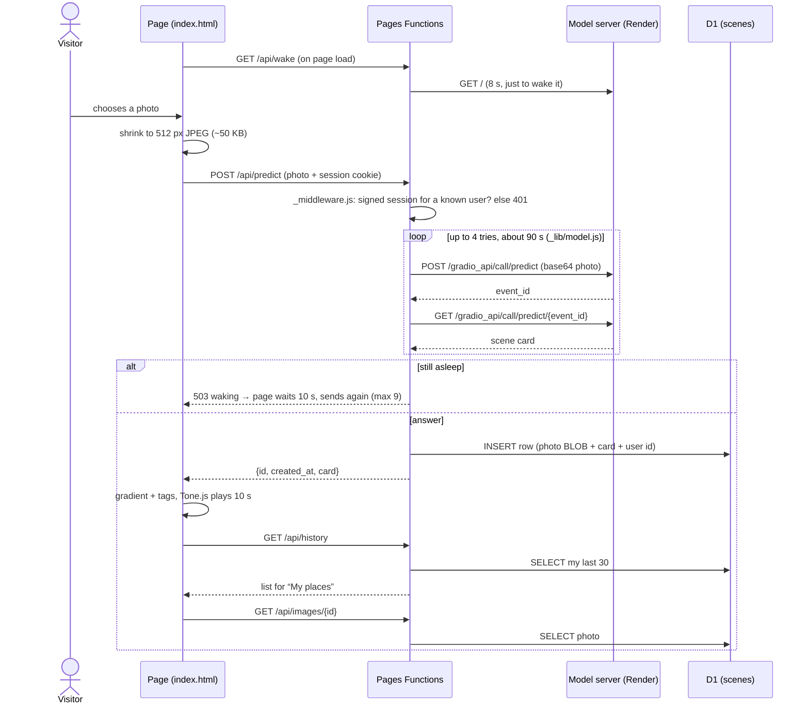

# Sequence diagrams · Chroma

Who talks to whom, in order. **S1** is one request: reading one photo. **S2** is one view of the live walk (the main product).
**S3** is one view in a jam: the driver's phone and a friend's phone play it at the same moment.

## S1 · Read a photo



## S2 · Live walk, one view

```mermaid
sequenceDiagram
  actor U as Walker (phone)
  participant P as Home page + Bo's engine (public/engine)
  participant S as Phone sensors (walk.js)
  participant F as Pages Functions
  participant R as Model server (Render)
  participant D as D1 (live_views)
  U->>P: log in, tap Walk on the home page
  P->>S: ask motion + compass permission, open camera
  P->>P: start the music (Tone.js)
  loop every 3.5 s walking / 10 s standing
    P->>P: camera frame -> 640 px JPEG
    P->>F: POST /gradio_api/call/predict (frame + session cookie)
    F->>F: _middleware.js: cookie ok? else 401
    F->>R: POST /gradio_api/call/predict (retry while waking, _lib/model.js)
    R-->>F: event_id
    F-->>P: event_id
    P->>F: GET /gradio_api/call/predict/{event_id}
    F->>R: GET result
    R-->>F: scene card
    F->>D: INSERT view (card + user id, no photo)
    F-->>P: scene card
    P->>P: same place -> keep style; new place (sure or seen twice) -> new sub-genre
  end
  S-->>P: steps per minute, GPS speed (every 1 s)
  P->>P: every 2 s: tempo follows the pace, layers build up (1-4) or drop when still
  S-->>P: turn > 60 degrees (onTurn) -> capture a new view now
  U->>P: tap Stop
  U->>F: back on the home page: GET /api/live -> "My walks" colour strip
```

## S3 · A jam, one view

```mermaid
sequenceDiagram
  actor A as Driver (phone A)
  participant PA as Page A (jam.js)
  participant F as Pages Functions (_lib/jam.js)
  participant D as D1 (jams, jam_members, jam_events)
  participant PB as Page B (jam.js)
  actor B as Friend (phone B)
  A->>PA: start a jam, invite B
  PA->>F: POST /api/jams {friends}
  F->>D: INSERT jam (driver = A) + members
  B->>PB: sees the invite, taps Join
  PB->>F: POST /api/jams/{id}/join
  loop about once a second, on every phone
    PA->>F: GET /api/jams/{id}?since=seq
    PB->>F: GET /api/jams/{id}?since=seq
    F-->>PB: new events, people, driver, server time (sets the phone's clock offset)
  end
  PA->>PA: new walk view read by the model (same as S2) -> scene card
  PA->>F: POST /api/jams/{id}/event {view: card, bpm, beat grid}
  F->>F: only the driver may send; seq + 1, apply_at = now + 2.5 s
  F->>D: INSERT jam_event
  F-->>PA: {seq, apply_at}
  F-->>PB: the same event on its next check-in
  par at apply_at, server time
    PA->>PA: Bo's engine plays the new card
  and
    PB->>PB: Bo's engine plays the same card, same seed, same beat
  end
  B->>PB: take over the camera
  PB->>F: POST /api/jams/{id}/takeover -> driver = B (event for everyone)
```
