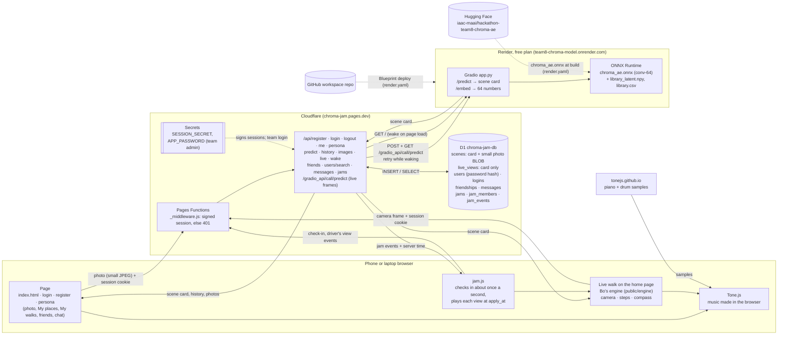

# System diagram · Chroma final version

The parts of the system and how they connect. Solid arrows run while someone uses the app; dashed arrows
run once, at deploy or build time. Every arrow points to the code that makes it (table below).

## Arrow check against the code

| Arrow | Code |
|---|---|
| page → Functions (photo + cookie) | `03_app/public/index.html` (`fetch("/api/predict")`) |
| live walk → Functions (frame) | `public/index.html` → `/gradio_api/call/predict` on our own app; Bo's engine in `public/engine` |
| login check, else 401 | `03_app/functions/_middleware.js`, `_lib/auth.js` (`readSession`) |
| accounts, sessions | `functions/api/register.js`, `login.js` (PBKDF2 hash, `users`, `logins`); `SESSION_SECRET` signs the cookie; `APP_PASSWORD` = team admin |
| friends, chat | `functions/api/friends/`, `users/search.js`, `messages.js`; `_lib/social.js` |
| jam check-in and events | `public/jam.js` ↔ `functions/api/jams/`, `_lib/jam.js` (`addEvent`: `apply_at` = now + 2.5 s) |
| Functions → Render, with retry | `functions/_lib/model.js` (`startJob`, `readJob`), `MODEL_URL` in `wrangler.toml` |
| wake on page load | `functions/api/wake.js` |
| Gradio → ONNX + library | `01_autoencoder/model_app/app.py` (`ort.InferenceSession`, `library_latent.npy`) |
| Functions ↔ D1 | `api/predict.js` (INSERT `scenes`), `gradio_api/call/predict/[id].js` (INSERT `live_views`), `api/history.js`, `api/live.js`, `api/images/[id].js` (SELECT); tables in `03_app/schema.sql`; binding `DB` in `wrangler.toml` |
| page / player → Tone.js | `index.html` `play()`, `Bo/src/chroma.js` |
| samples from tonejs.github.io | `Bo/src/chroma.js` (drum samples, Salamander piano) |
| Hugging Face → Render at build | `render.yaml` `buildCommand` (`curl … /resolve/main/chroma_ae.onnx`) |
| GitHub → Render | `render.yaml` (`rootDir`, Blueprint) |

**Not drawn, on purpose:** the optional "Offline places" button in the live player loads CLIP in the browser
(`Bo/src/offline.js`: transformers.js from jsDelivr, model `Xenova/clip-vit-base-patch32` from Hugging Face). It is
only used when the model server can't be reached, and it is not part of the normal path.

**Changed since Tuesday (Miro):** there is no R2 (it needs a payment card), so small photos are stored as BLOBs in D1. The
"Worker" is now Pages Functions in the same project as the page. The live walk now goes through our Functions
instead of calling Render directly from the browser. On Thursday the shared password became accounts, with friends, chat
and jams; the app moved to chroma-jam.pages.dev (Bhavini's Cloudflare account, database `chroma-jam-db`).
